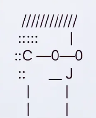

> Maak een game in Bash waarin de speler al spelend leert werken met de Linux-terminal en Bash-commando's.

# Tips 
- **Kies een thema:** bijvoorbeeld een avontuur, een ontsnappingsspel, een detective of een survivalgame.
- **Begin met duidelijke instructies:** leg uit wat het doel van de game is, wat de speler moet doen en hoe die het spel moet spelen.
- **Leer Bash aan:** laat de speler Bash commando's gebruiken om opdrachten op te lossen.
- **Bouw de moeilijkheid op:** begin met eenvoudige opdrachten en maak ze geleidelijk uitdagender.
- **Geef feedback:** leg uit waarom een antwoord juist of fout is en geef eventueel hints.
- **Maak het interactief:** laat de speler keuzes maken, problemen oplossen en nieuwe locaties ontdekken.
- **Test je game:** speel je eigen game en laat ook iemand anders hem uitproberen.
- **Gebruik ASCII-art:** maak je game visueel aantrekkelijk met tekeningen van tekst en symbolen in de terminal, bijvoorbeeld een kaart of characters.  
  {: .frame }{: width='200px' }  

# Puntenverdeling

De opdracht bestaat uit meerdere fases.

## v0.1: Eerste testversie
Lever een eerste speelbare versie van je game in.

 

## v0.2: Feedback verwerken

Bekijk de feedback die je op je eerste testversie hebt gekregen. Verwerk deze feedback in je game en verbeter waar nodig.

 

## v1.0: Final version
Verwerk de ontvangen feedback en lever een verbeterde versie van je game in.

 
