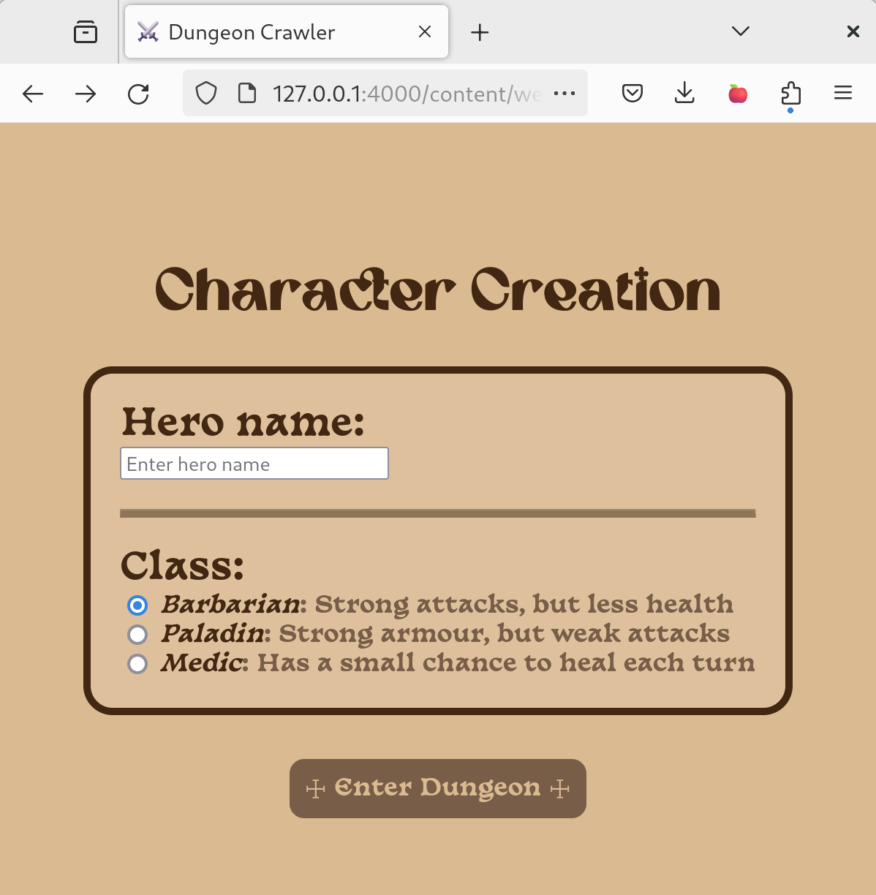
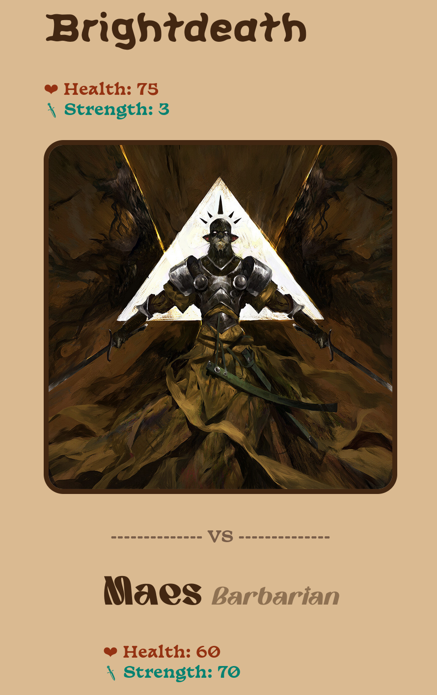
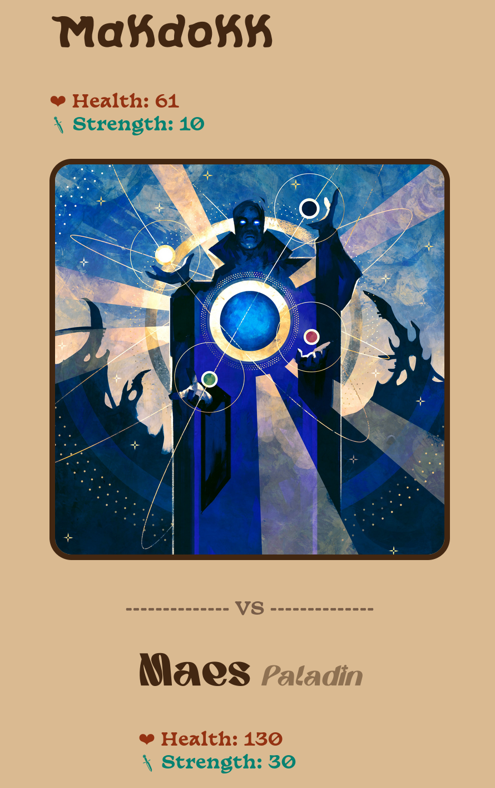
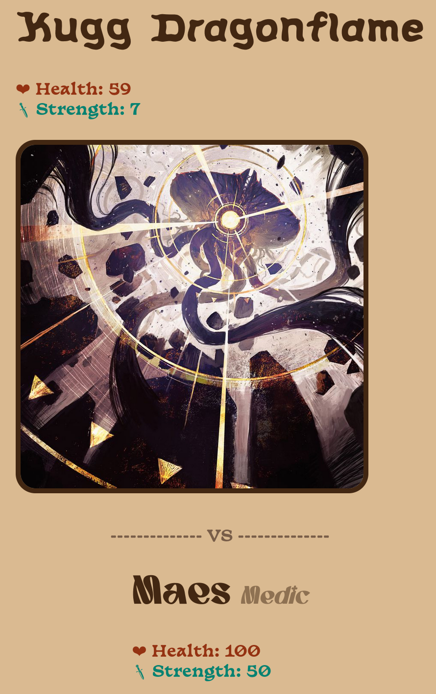

> Een dungeon crawler game is een spel waarin je door **willekeurig gegenereerde levels** of dungeons navigeert

# Vormgeving

Je game moet niet alleen werken, maar ook aangenaam zijn om te spelen.

Besteed aandacht aan:
- Een herkenbare fantasy-, horror- of andere gekozen stijl.
- Een duidelijke hiërarchie tussen titels, stats, afbeeldingen en knoppen.
- Knoppen die duidelijk aangeven wat ze doen.
- Feedback bij acties, zoals schade, genezing, winst of verlies.
- Een layout die bruikbaar blijft op verschillende schermformaten.
- Gebruik afbeeldingen, iconen, achtergronden en eventueel ASCII-art om je dungeon crawler een eigen identiteit te geven.

# Onderdelen





## Random enemies

Genereer een **willekeurige** vijand *(enemy)* met verschillende random elementen.

Je enemy bevat minstens:
- **Naam:** kies willekeurig een naam.
- **Stats:** genereer willekeurige waarden voor bijvoorbeeld `health`, `strength` en `defense`.
- **Afbeelding:** toon een afbeelding die bij de vijand hoort.

{: .frame }{: width='500px' }

## Start menu

Maak een startmenu dat bij de sfeer van jouw dungeon crawler past.

{: .frame }{: width='500px' }



Maak een character creation menu waarin de speler zijn eigen hero samenstelt.

De speler kan minstens de volgende eigenschappen kiezen:
- **Hero name:** de speler geeft zijn personage een naam.
- **Hero class:** de speler kiest een klasse, bijvoorbeeld `warrior`, `mage` of `rogue`.

{: .frame }{: width='500px' }

Toon de **naam** van je hero en geef **elke class unieke stats**.

Zorg ervoor dat:
- De gekozen naam zichtbaar blijft tijdens het spel.
- De speler duidelijk ziet welke class geselecteerd is.
- Iedere class andere stats krijgt.
- De gekozen hero daadwerkelijk met deze eigenschappen aan het spel begint.

{: .frame }{: width='260px' }
{: .frame }{: width='260px' }
{: .frame }{: width='260px' }

## Game loop

De game bestaat uit een **oneindige spelcyclus** waarin de speler telkens een nieuwe encounter krijgt.

Bij iedere beurt gebeurt minstens het volgende:
1. Genereer een nieuwe encounter.
2. Toon de actuele informatie van de hero (naam, class, health en andere stats).
3. Laat de speler een actie uitvoeren.
4. Werk de spelstatus bij (health, level, inventory, ...).
5. Controleer of de hero nog leeft.
6. Herhaal de cyclus of toon een game-over-scherm.

**Tips:**  
- De game moet meerdere opeenvolgende encounters kunnen genereren.
- De moeilijkheid moet geleidelijk toenemen.

### Game over

Toon een game-over-scherm met minstens:
- De naam van de hero.
- Hoe ver de speler geraakt is of welke score behaald werd.
- Een knop om opnieuw te spelen.

Wanneer de speler opnieuw begint, wordt een nieuwe run gestart. De speler moet opnieuw een hero kunnen aanmaken en de game mag geen oude stats of voortgang blijven gebruiken.

# Extra uitdaginen

**Enemies:**
- Geef vijanden verschillende types, zoals goblin, skeleton of dragon.
- Laat de stats afhangen van het type vijand.
- Geef iedere vijand een willekeurige zeldzaamheid, bijvoorbeeld common, rare of legendary.
- Zorg ervoor dat je niet twee keer exact dezelfde combinatie van eigenschappen krijgt.

**Hero:**
- Laat de speler een afbeelding of portret kiezen.
- Geef iedere class een unieke vaardigheid.
- Toon een korte beschrijving van de sterke en zwakke punten van iedere class.

**Game loop:**
- Voeg een eindbaas toe
- Inventory: verzamel wapens, armor en potions.
- Level-ups: laat de hero ervaring verzamelen en sterker worden.

**Game over:**
- localStorage:
  - Achievements
  - High scores
  - Save system: laat de speler zijn voortgang bewaren
- Laat de speler goud verzamelen om upgrades te kopen.
- Voeg een inventory toe waarin de speler voorwerpen kan bewaren.
