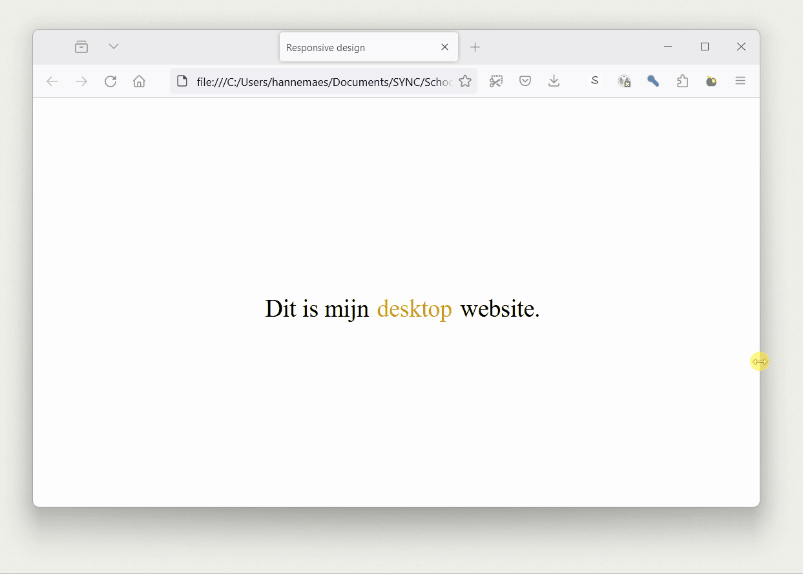

# Min- en max-values

```css
img {
  width: 90%;
  max-width: 300px;
}

img {
  width: 50%;
  min-width: 50px;
}
```

In CSS stellen min en max values de **minimale en maximale grootte van een element** in. Dit is handig bij het ontwerpen van responsive websites, omdat het elementen kan helpen zich aan te passen aan verschillende schermgroottes en apparaten **zonder media-queries** te moeten gebruiken.

Het werken met min en max values is vaak simpeler *(op een goede manier)* dan werken met media-queries, omdat je per element enkel een minimale of maximale grootte moet instellen, zonder je ontwerp te moeten gaan aanpassen voor meerdere schermformaten.

**Voorbeeld:**

```css
.alwaysMaxWidth {
    width: 90%;
    max-width: 300px;
}
```

```html
<div class="alwaysMaxWidth">
    Deze elementen zullen een maximale grootte hebben, zolang zullen nooit groter worden dan 300px.<br>
    Dit is zeer handig afbeeldingen die zo groot mogelijk moeten zijn zonder verlies van kwaliteit.
</div>

```



# Media queries

Media queries stellen ons in staat om **specifieke CSS-regels** toe te passen op basis van de **eigenschappen van het apparaat**.



```html
<body>
	Dit is mijn <span class="text"></span> website.
</body>
```

```css
.text::before {
    content: 'desktop';
    color: goldenrod;
    margin-left:  10px;
    margin-right: 10px;
}

/* gebruik deze styling als het scherm 500px of minder breed is */
@media screen and (max-width: 500px) {
    body {
        background-color: black;
        color: white;
    }
    
    .text::before {
        content: 'mobile';
    }
}
```

## Oriëntatie (Liggend/Portret)

```css
/* Portretmodus */
@media only screen and (orientation: portrait) {
  body {
    background-color: black;
  }
}

/* Liggende */
@media only screen and (orientation: landscape) {
  body {
    background-color: white;
  }
}
```

## Scherm breedte

```css
/* Schermen breder dan 700px */
@media screen and (min-width: 700px) {
  body {
    background-color: black;
  }
}

/* Schermen tussen 530px en 700px breed */
@media screen and (max-width: 700px) and (min-width: 530px) {
  body {
    background-color: grey;
  }
}

/* Schermen kleiner dan 530px breed */
@media (max-width: 530px) {
  body {
    background-color: white;
  }
}
```

## Volgorde is belangrijk

Media queries mag je **overal in je CSS-bestand** zetten. Wat telt, is de **volgorde van je code**.

> De **laatste** regel wint!

```css
@media (min-width: 768px) {
  body {
    background: red;
  }
}

body {
  background: blue;
}
```

Bij gelijke specificiteit geldt: de laatste regel wint.  
Dus zelfs als de media query actief is, wordt die overschreven door `.body { background: blue; }`  
**Je website zal dus alijd blauw zijn.**

Correcte code:
```css
body {
  background: blue;
}

@media (min-width: 768px) {
  body {
    background: red;
  }
}
```

> Daarom zet je media queries best **onderaan** het bestand!

## Media queries combineren

Het is mogelijk meerdere **media queries** met elkaar te **combineren**.


```html
<body>
    <p class="orientatie">Oriëntatie</p>
    <p class="text">Font-size</p>
</body>
```

```css
body {
    font-size: 30px;
    color: grey;
}

/* ********** */
/* orientatie */
/* ********** */

/* Portrait (verticaal) */
@media only screen and (orientation: portrait) {
    body {
        background-color: black;
        color: white;
    }
    .orientatie::after {
        content: ': portrait';
    }
}
  
/* Landscape (horizontaal) */
@media only screen and (orientation: landscape) {
    body {
        background-color: white;
        color: black;
    }
    .orientatie::after {
        content: ': landscape';
    }
}

/* ********** */
/* screensize */
/* ********** */

/* Schermen breder dan 700px */
@media screen and (min-width: 700px) {
    .text {
        font-size: 100px;
    }
    .text::after {
        content: ': 100px';
    }
}

/* Schermen tussen 700px en 530 px breed */
@media screen and (max-width: 700px) and (min-width: 530px) {
    .text {
        font-size: 80px;
    }
    .text::after {
        content: ': 80px';
    }
}

/* Schermen kleiner dan 530px breed */
@media (max-width: 530px) {
    .text {
        font-size: 30px;
    }
    .text::after {
        content: ': 30px';
    }
}
```

## Media query breakpoints

Media query breakpoints zijn de specifieke schermgroottes die je instelt om je design aan te passen, dit zijn veelgebruikte breakpoints.  
Maar pas op, met het grote veranderende aanbod aan toestellen kunnen er altijd uitzonderingen zijn.

- `576px` voor **portrettelefoons**
- `768px` voor **tablets**
- `992px` voor **laptops**
- `1200px` voor **desktop computers**

# Developer tools

Zowel **Firefox** als **Chrome** hebben ingebouwde opties voor het ontwikkelen van mobiele en responsieve websites in hun **Developer Tools** via  of  of .  



# Praktische tips

## Elementen tonen en verbeteren

Je kan elementen **verbergen** met `display:none`, bijvoorbeeld bij een dropdown of mobiele navigatie.

```css
.hidden {
  display: none;
}
```

Je kan elementen terug zichtbaar maken met:

- `display: block`: Toont het element als een blok. Het neemt de hele breedte in van zijn container.  
   **Zoals `<div>`-elementen.**
- `display: inline`: Toont het element naast andere elementen zonder een nieuwe regel te starten.  
   **Zoals `<span>`-elementen.**

## Fullscreen overlay

Fullscreen overlays worden in webdesign vaak gebruikt om **fullscreen menu's of pop-ups** te maken.

```css
.fixed-button {
  position: fixed;
  top: 0px;
  right: 0px;
  z-index: 1;
  background: black;
  opacity: 0.9;
}
```

- `position: fixed` zet een element vast op het scherm, los van andere elementen. Het blijft altijd op dezelfde plek, ook als je scrolt. Het wordt gepositioneerd ten opzichte van het browservenster, niet van een ander element.
- Met `top`, `bottom`, `left` en `right` kan je de plaats bepalen.
- De `z-index` bepaalt welk element bovenop komt te liggen als meerdere elementen elkaar overlappen. Een element met een hogere z-index ligt bovenop een element met een lagere z-index. De standaard z-index is 0.

# Oefeningen

## Oefening 1: Responsive media gallery




Maak een **responsive gallery website** met minstens 3 afbeelding.
- Desktop:
    - De **afbeeldingen** staan in een **rij**.
    - De **achtergrond** van de titel is **doorschijnend**.
- Mobile:
    - De **afbeeldingen** staan in een **kolom**.
    - De **achtergrond** van de titel heeft een **kleur**.
    


## Oefening 2: Sidebar menu



Maak een sidebar menu met deze eigenschappen:
- De sidebar neemt **20%** van de **breedte** van de pagina in.
- De sidebar moet **tussen de 130 en 250 pixels breed** blijven.
- De **1e letter** van je hoofdtitel heeft een andere kleur, dit doe je met een speciale CSS-selector.
- Voor de ondertitels staat een speciaal **ASCII-symbool** in een andere kleur. Op [deze website](https://ss64.com/ascii.html) kan je speciale ASCII-symbolen terugvinden.
- De links zijn **onderlijnt** in een **andere kleur**.
- Je sidebar staat **verticaal gecentreerd**.

## Opdracht 3: Alle technieken combineren

Maak een nieuwe website via de regels van responsive design.  
Je website heeft deze zaken:

- Maak 2 tekstblokken en daarin tekst van 12 pixels groot.
  - De eerste neemt 10% van de breedte van de pagina in, de tweede 30%.
  - Als het scherm **horizontaal** staat _(het is breder dan het hoog is, zoals desktops en laptops)_, staan de tekstblokken naast elkaar.
  - Als het scherm **verticaal** staan _(het is hoger dan het breed is, zoals bij smartphones)_, staan de tekstblokken onder elkaar.
- Laat de tekstgrootte aanpassen aan de hand van de breedte van het scherm:
  - Schermen **kleiner dan 300 pixels** -> tekstgrootte van **30 pixels**.
  - Schermen **tussen 300 en 600 pixels** -> tekstgrootte van **20 pixels**.
- **Navigatie balk** die overgaat in een **hamburger menu** wanneer de pagina kleiner is dan 500 pixels.
  - De **navigatie balk** bevat **links een titel** en **rechts links**.
  - Het **hamburger menu** opent een **fullscreen overlay menu** waarin de titel bovenaan staat, en de links onder elkaar. Het fullscreen overlay menu openen doe je best via **JavaScript**.
